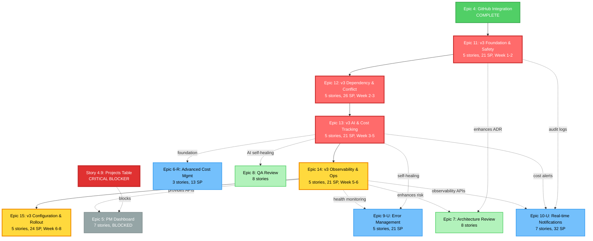

# Dark Software Factory - Epic Dependency Graph

**Generated:** 2025-12-19  
**Purpose:** Visual representation of epic dependencies including v3 system flow implementation

---

## Epic Dependency Graph

This diagram shows the relationships and dependencies between all epics in the Dark Software Factory project. The v3 epics (11-15) form the foundation for several backlog epics.



---

## Dependency Summary

### V3 Epic Chain (Sequential)

Epic 11 → Epic 12 → Epic 13 → Epic 14 → Epic 15

**Critical Path:** 6-8 weeks

- Epic 11 must complete before Epic 12 can start
- Epic 12 must complete before Epic 13 can start
- And so on...

### Backlog Epic Dependencies

#### Epic 5: PM Dashboard

**Blockers:**

- Story 4.9 (Projects Table) - CRITICAL
- Epic 14.5 (Real-Time Observability APIs) - for live data

**Can Start After:** Story 4.9 complete AND Epic 14 complete

---

#### Epic 6-R: Advanced Cost Management

**Dependencies:**

- Epic 13 (AI Cost Tracking) - provides foundation

**Can Start After:** Epic 13 complete

---

#### Epic 7: Architecture Review

**Enhanced By:**

- Epic 11.2 (Audit Logger) - reduces ADR generation effort by ~50%
- Epic 14.1 (PR Risk Assessor) - provides risk scores

**Can Start:** Immediately (no hard blockers, but effort reduced if started after v3)

---

#### Epic 8: QA Review

**Dependencies:**

- Epic 3 (QA Automation) - already complete
- Epic 13 (AI Self-Healing) - for automated fix attempts

**Can Start After:** Epic 13 complete

---

#### Epic 9-U: Production Error Management

**Dependencies:**

- Epic 13 (AI Self-Healing) - provides self-healing logic
- Epic 14 (Health Monitoring) - provides monitoring infrastructure

**Can Start After:** Epic 13 AND Epic 14 complete

---

#### Epic 10-U: Real-time Notifications

**Dependencies:**

- Epic 11 (Audit Logs) - provides log data
- Epic 13 (Cost Alerts) - provides budget alerts
- Epic 14 (Observability APIs) - provides backend data streams

**Can Start After:** Epic 14 complete (Epic 11, 13 already done by then)

---

## Recommended Execution Order

### Phase 1: V3 Foundation (HIGH Priority)

**Weeks 1-5**

1. **Epic 11** - v3 Foundation & Safety (2 weeks)
2. **Epic 12** - v3 Dependency & Conflict (1 week)
3. **Epic 13** - v3 AI Enhancements & Cost (2 weeks)

**Parallel Work Available:**

- Story 4.9 (Projects Table) can be done in parallel with Epic 11

### Phase 2: V3 Operations + Business Value (MEDIUM Priority)

**Weeks 5-10** 4. **Epic 14** - v3 Observability & Ops (2 weeks) 5. **Epic 5** - PM Dashboard (3 weeks) - _Unblocked after Story 4.9 + Epic 14_ 6. **Epic 6-R** - Advanced Cost Management (1 week) - _Requires Epic 13_ 7. **Epic 15** - v3 Configuration (2 weeks)

**Parallel Work Available:**

- Epic 5 and Epic 6-R can run in parallel (different teams)

### Phase 3: Workflows & Reviews (LOWER Priority)

**Weeks 11+** 8. **Epic 7** - Architecture Review (2-3 weeks) 9. **Epic 8** - QA Review (2-3 weeks) 10. **Epic 9-U** - Production Error Management (2 weeks) 11. **Epic 10-U** - Real-time Notifications (3 weeks)

**Parallel Work Available:**

- Epic 7 and Epic 8 can run in parallel (different concerns)
- Epic 9-U and Epic 10-U can run in parallel

---

## Critical Path Analysis

### Longest Dependency Chain

```
Epic 4 (complete)
  → Epic 11 (2 weeks)
  → Epic 12 (1 week)
  → Epic 13 (2 weeks)
  → Epic 14 (2 weeks)
  → Epic 10-U (3 weeks)

Total: 10 weeks
```

### Epic 5 Critical Path

```
Story 4.9 (1 week) + Epic 14 (7 weeks from start)
  → Epic 5 (3 weeks)

Total from start: 10 weeks
```

### Minimum Timeline to Complete All Epics

**With 2 Parallel Teams:**

- Phase 1: 5 weeks (v3 foundation, sequential)
- Phase 2: 5 weeks (Epic 14 + Epic 5/6-R + Epic 15, parallel)
- Phase 3: 5 weeks (Epic 7/8 + Epic 9-U/10-U, parallel)

**Total: ~15 weeks (3.75 months)**

**With 1 Team (Sequential):**

- All epics sequential = ~26 weeks (6.5 months)

---

## Blockers & Risks

### Current Blockers

1. **Story 4.9 (Projects Table):** Blocks Epic 5
   - **Impact:** PM Dashboard cannot start
   - **Mitigation:** Complete Story 4.9 immediately
   - **Estimated Effort:** 3-4 hours

### Dependency Risks

1. **Epic 11 Foundation:** Blocks all v3 epics
   - **Risk:** Any delays cascade to entire v3 chain
   - **Mitigation:** Prioritize Epic 11, allocate best engineers

2. **Epic 14 Observability:** Blocks Epic 5, 9-U, 10-U
   - **Risk:** Multiple epics waiting for completion
   - **Mitigation:** Ensure Epic 14 quality is high, test thoroughly

---

## Parallelization Opportunities

### Phase 1 (Weeks 1-5)

- **Primary:** Epic 11 → 12 → 13 (sequential, cannot parallelize)
- **Secondary:** Story 4.9 (different team, can run in parallel)

### Phase 2 (Weeks 5-10)

- **Track 1:** Epic 14 → Epic 15
- **Track 2:** Epic 5 (after Story 4.9 + Epic 14)
- **Track 3:** Epic 6-R (after Epic 13, only 1 week)

**Teams Needed:** 2 teams for optimal velocity

### Phase 3 (Weeks 11+)

- **Track 1:** Epic 7 + Epic 9-U (sequential on same track)
- **Track 2:** Epic 8 + Epic 10-U (sequential on same track)

**Teams Needed:** 2 teams for optimal velocity

---

## Enhanced Dependency Graph (With Story-Level Detail)

For a more detailed view showing story-level dependencies within epics, see:

- `/docs/implementation-plan-v3.md` - Full implementation breakdown
- `/docs/sprint-artifacts/epic-11-v3-foundation-safety.md` - Epic 11 stories
- `/docs/sprint-artifacts/epic-12-v3-dependency-conflict-management.md` - Epic 12 stories
- `/docs/sprint-artifacts/epic-13-14-15-v3-remaining.md` - Epic 13-15 stories

---

## Legend

### Node Colors

- 🔴 **Red (v3 High Priority):** Epic 11, 12, 13 - Foundation work, blocks everything
- 🟡 **Yellow (v3 Medium Priority):** Epic 14, 15 - Operations and rollout
- ⚫ **Gray (Blocked):** Epic 5 - Waiting for blockers to clear
- 🔵 **Blue (Backlog Medium):** Epic 6-R, 9-U, 10-U - Depends on v3
- 🟢 **Green (Backlog Low):** Epic 7, 8 - Can start anytime, enhanced by v3
- ✅ **Dark Green (Complete):** Epic 4 - Already done

### Line Types

- **Solid Line (→):** Hard dependency, must complete before
- **Dotted Line (-.->):** Provides enhancement, not blocking

---

## Next Steps

1. ✅ Review dependency graph
2. ⏳ Start Story 4.9 (Projects Table) - CRITICAL
3. ⏳ Plan Epic 11 sprint (assign team, create story files)
4. ⏳ Confirm 2-team parallelization strategy
5. ⏳ Set up project board with dependency tracking

---

**Generated by:** Antigravity  
**Reference:** `/docs/sprint-artifacts/v3-epic-impact-analysis.md`
