# Dark Software Factory - Task Processing Flow v2

Complete end-to-end flow with intelligent failure handling, dependency management, and AI-powered ClickUp integration.

## Main Flow Diagram

```mermaid
flowchart TD
    Start([START: ClickUp Task Created]) --> Polling

    Polling[ClickUp Polling Orchestrator<br/>Polls every 60s] --> Queue1{{"ticket-intake-queue"}}
    Queue1 --> Intake

    Intake[Ticket Intake Consumer<br/>Validates task] --> ValidCheck{Valid?}
    ValidCheck -->|Yes| DepCheck[AI Dependency Analyzer<br/>Check ClickUp dependencies]
    ValidCheck -->|No| UpdateFail1[AI ClickUp Agent:<br/>Update status to 'Invalid']
    UpdateFail1 --> FailIntake[Validation Failed:<br/>Notify & End]

    DepCheck --> HasDeps{Dependencies<br/>exist?}
    HasDeps -->|No| UpdateStatus1[AI ClickUp Agent:<br/>Auto-update status]
    HasDeps -->|Yes| WaitDeps{All deps<br/>merged?}
    WaitDeps -->|No| Queue1
    WaitDeps -->|Yes| UpdateStatus1

    UpdateStatus1 --> BranchSelect[AI Branch Strategist<br/>Select base branch]
    BranchSelect --> Queue2{{"ai-execution-queue"}}

    Queue2 --> AIExec[AI Execution Consumer<br/>Generates code via Cursor CLI]
    AIExec --> AICheck{Success?}
    AICheck -->|Yes| UpdateStatus2[AI ClickUp Agent:<br/>Update to QA stage]
    AICheck -->|No| FailAnalyze[AI Failure Analyzer<br/>Categorize failure]

    FailAnalyze --> FailType{Failure<br/>Type?}
    FailType -->|Transient| RetryCheck{Retries<br/>< Max?}
    FailType -->|Code Issue| AIFix[AI Self-Heal<br/>Analyze & fix code]
    FailType -->|Requirements| ManualReview[Flag for Manual Review<br/>Update ClickUp]

    RetryCheck -->|Yes| Queue2
    RetryCheck -->|No| CheckCleanup
    AIFix --> FixCheck{Fixed?}
    FixCheck -->|Yes| Queue2
    FixCheck -->|No| CheckCleanup

    CheckCleanup{Cleanup<br/>Policy?}
    CheckCleanup -->|Manual Review| Archive[Archive Workspace<br/>Await human action]
    CheckCleanup -->|Auto Delete| Cleanup[Delete Workspace<br/>Update ClickUp to 'Failed']

    UpdateStatus2 --> Queue3{{"qa-check-queue"}}

    Queue3 --> QA[QA Orchestrator Consumer<br/>Runs tests, lint, security]
    QA --> QACheck{Passed?}
    QACheck -->|Yes| UpdateStatus3[AI ClickUp Agent:<br/>Update to PR stage]
    QACheck -->|No| QAFix[AI QA Fixer<br/>Analyze & fix issues]

    QAFix --> QAFixCheck{Fixed?}
    QAFixCheck -->|Yes| Queue3
    QAFixCheck -->|No| FailQA[QA Failed:<br/>Log & Continue]
    FailQA --> UpdateStatus3

    UpdateStatus3 --> Queue4{{"github-push-trigger-queue"}}

    Queue4 --> Commit[GitHub Commit Orchestrator<br/>AI commits & pushes code]
    Commit --> CommitCheck{Success?}
    CommitCheck -->|Yes| UpdateStatus4[AI ClickUp Agent:<br/>Update to PR Created]
    CommitCheck -->|No| CommitRetry[AI Commit Fixer<br/>Resolve conflicts]

    CommitRetry --> CommitFixed{Fixed?}
    CommitFixed -->|Yes| Queue4
    CommitFixed -->|No| FailCommit[Commit Failed:<br/>Update ClickUp & alert]

    UpdateStatus4 --> Queue5{{"github-pr-created-queue"}}

    Queue5 --> PR[GitHub PR Orchestrator<br/>AI creates Pull Request]
    PR --> PRCheck{Success?}
    PRCheck -->|Yes| UpdateStatus5[AI ClickUp Agent:<br/>Update to Deployed]
    PRCheck -->|No| FailPR[PR Creation Failed:<br/>Update ClickUp & alert]

    UpdateStatus5 --> Deploy[Deployment Orchestrator<br/>Triggers GitHub Actions]
    Deploy --> DeployPoll[Poll deployment status<br/>Exponential backoff: 30s→60s→90s]
    DeployPoll --> DeployCheck{Status?}
    DeployCheck -->|Success| UpdateStatus6[AI ClickUp Agent:<br/>Update to Done]
    DeployCheck -->|Running| DeployPoll
    DeployCheck -->|Failed| FailDeploy[Deployment Failed:<br/>Update ClickUp & alert]
    DeployCheck -->|Timeout| FailTimeout[Deployment Timeout:<br/>30min exceeded]

    UpdateStatus6 --> CleanupSuccess[Cleanup Workspace<br/>Archive branch]
    CleanupSuccess --> End([END: Task Complete])

    style Start fill:#99e9a5,stroke:#1e7b34
    style End fill:#99e9a5,stroke:#1e7b34
    style Polling fill:#a5d8ff,stroke:#1971c2
    style Intake fill:#a5d8ff,stroke:#1971c2
    style DepCheck fill:#d0bfff,stroke:#7950f2
    style BranchSelect fill:#d0bfff,stroke:#7950f2
    style AIExec fill:#ffc078,stroke:#e67700
    style FailAnalyze fill:#ffd8a8,stroke:#fd7e14
    style AIFix fill:#ffd8a8,stroke:#fd7e14
    style QA fill:#e599f7,stroke:#9c36b5
    style QAFix fill:#f3d9fa,stroke:#c084fc
    style Commit fill:#8ce99a,stroke:#2b8a3e
    style CommitRetry fill:#b2f2bb,stroke:#51cf66
    style PR fill:#8ce99a,stroke:#2b8a3e
    style Deploy fill:#c0eb75,stroke:#5c940d
    style DeployPoll fill:#c0eb75,stroke:#5c940d
    style UpdateStatus1 fill:#d0bfff,stroke:#7950f2
    style UpdateStatus2 fill:#d0bfff,stroke:#7950f2
    style UpdateStatus3 fill:#d0bfff,stroke:#7950f2
    style UpdateStatus4 fill:#d0bfff,stroke:#7950f2
    style UpdateStatus5 fill:#d0bfff,stroke:#7950f2
    style UpdateStatus6 fill:#d0bfff,stroke:#7950f2
    style UpdateFail1 fill:#d0bfff,stroke:#7950f2
    style FailIntake fill:#ffc9c9,stroke:#c92a2a
    style ManualReview fill:#ffe066,stroke:#fab005
    style Archive fill:#ffe066,stroke:#fab005
    style Cleanup fill:#ffc9c9,stroke:#c92a2a
    style FailQA fill:#ffe066,stroke:#fab005
    style FailCommit fill:#ffc9c9,stroke:#c92a2a
    style FailPR fill:#ffc9c9,stroke:#c92a2a
    style FailDeploy fill:#ffc9c9,stroke:#c92a2a
    style FailTimeout fill:#ffc9c9,stroke:#c92a2a
    style CleanupSuccess fill:#b2f2bb,stroke:#51cf66
    style Queue1 fill:#f1f3f5,stroke:#868e96
    style Queue2 fill:#f1f3f5,stroke:#868e96
    style Queue3 fill:#f1f3f5,stroke:#868e96
    style Queue4 fill:#f1f3f5,stroke:#868e96
    style Queue5 fill:#f1f3f5,stroke:#868e96
```



## Key Improvements

### 🆕 **1. AI-Powered ClickUp Integration**

**AI ClickUp Agent** automatically:

- Fetches current ClickUp list status flow
- Determines appropriate status for each system stage
- Updates ticket status throughout lifecycle
- Sets estimates, due dates, assignments per PM's configuration
- Adapts to different ClickUp configurations without code changes

**Status Update Points:**

- After validation → "In Progress" or equivalent
- After AI code generation → "Code Review" or "QA"
- After QA → "Ready for PR"
- After PR creation → "In Review"
- After deployment → "Done"
- On failure → "Blocked" or "Failed"

---

### 🆕 **2. Intelligent Failure Handling**

**AI Failure Analyzer** categorizes failures:

| Failure Type     | AI Action                                    | Example                              |
| ---------------- | -------------------------------------------- | ------------------------------------ |
| **Transient**    | Auto-retry (up to max configured)            | Network timeout, API rate limit      |
| **Code Issue**   | AI Self-Heal: analyze error, fix code, retry | Compilation error, syntax issue      |
| **Requirements** | Flag for manual review, update ClickUp       | Ambiguous requirements, missing info |

**Intelligent Retry Logic:**

- Not just blind retries - AI analyzes failure reason
- Attempts self-healing for code issues
- Only escalates when truly stuck
- Respects configurable retry limits

---

### 🆕 **3. Dependency Management**

**AI Dependency Analyzer:**

- Reads ClickUp task dependencies (blocking/blocked by relationships)
- Checks if dependent PRs are merged
- Re-queues ticket if dependencies not ready
- Polls every 60s for dependency status updates

**AI Branch Strategist:**

- Determines optimal base branch:
  - Main/configured base (if no dependencies)
  - Feature branch (if dependency exists but not merged)
  - Latest merged commit (if dependency just merged)
- Handles branch conflicts intelligently
- Auto-rebases when necessary

**Smart Branching Flow:**

```
Ticket A (no deps) → branch from main
Ticket B (depends on A, A not merged) → branch from Ticket A's feature branch
Ticket C (depends on B, B merged) → branch from main (includes B's changes)
```

---

### 🆕 **4. Configurable Workspace Cleanup**

**Dashboard UI Configuration Options:**

```yaml
workspace_cleanup:
  # Option 1: Max retry-based cleanup
  max_retries: 3 # Delete workspace after N failures

  # Option 2: Manual review flag
  require_manual_review: true # Archive instead of delete

  # Option 3: Time-based cleanup
  archive_after_hours: 24 # Auto-archive failed workspaces after 24h
  delete_after_days: 7 # Auto-delete archived workspaces after 7 days

  # Option 4: Success cleanup
  cleanup_on_success: true # Delete workspace after successful deployment
  keep_successful_days: 3 # Or archive for N days before deletion
```

**Cleanup Actions:**

- **Archive:** Move to archive storage, keep for debugging, update ClickUp
- **Delete:** Permanently remove workspace, delete local branch
- **Manual Review:** Flag in dashboard, await human decision

---

### 🆕 **5. AI Self-Healing QA**

**AI QA Fixer:**

- When tests fail: analyzes test output, fixes code, re-runs
- When lint fails: auto-fixes linting issues, re-runs
- When security scan fails: analyzes vulnerabilities, applies patches
- Configurable max fix attempts before escalation

Benefits:

- Reduces manual intervention
- Faster iteration cycles
- Learning from failures

---

### 🆕 **6. AI Commit Conflict Resolution**

**AI Commit Fixer:**

- Detects merge conflicts when pushing
- Analyzes conflicting changes
- Resolves conflicts intelligently
- Re-attempts commit
- Escalates if unable to resolve

---

## Updated Error Handling Summary

| Stage            | Failure Action            | AI Intervention              | Retry?                | Cleanup Policy |
| ---------------- | ------------------------- | ---------------------------- | --------------------- | -------------- |
| **Validation**   | AI updates ClickUp status | Categorize failure reason    | ❌ No                 | Immediate      |
| **AI Execution** | AI analyzes & categorizes | ✅ Self-heal for code issues | ✅ Yes (configurable) | Per config     |
| **QA Checks**    | AI auto-fixes issues      | ✅ Fix & retry               | ✅ Yes (configurable) | Continue       |
| **Commit**       | AI resolves conflicts     | ✅ Conflict resolution       | ✅ Yes (limited)      | Per config     |
| **PR Creation**  | AI updates ClickUp        | Retry with adjusted params   | ✅ Yes (limited)      | Per config     |
| **Deployment**   | AI updates ClickUp        | Alert & manual review        | ❌ No                 | Archive        |

---

## RabbitMQ Queues (Unchanged)

1. `ticket-intake-queue` - Raw ClickUp task events
2. `ai-execution-queue` - Validated tasks ready for AI processing
3. `qa-check-queue` - Code generated, ready for QA
4. `github-push-trigger-queue` - QA complete, ready for commit
5. `github-pr-created-queue` - Code committed, ready for PR & deployment

---

## New AI Agent Components

### 🤖 **AI ClickUp Agent**

- **Purpose:** Autonomous ClickUp workflow management
- **Capabilities:**
  - Read list status flow
  - Update ticket status
  - Set estimates, dates, assignments
  - Follow PM-configured workflows
- **Triggers:** Every major stage transition

### 🤖 **AI Dependency Analyzer**

- **Purpose:** Detect and manage ticket dependencies
- **Capabilities:**
  - Read ClickUp dependencies
  - Check PR merge status
  - Re-queue tickets when deps ready
- **Triggers:** Before AI execution

### 🤖 **AI Branch Strategist**

- **Purpose:** Smart branch selection
- **Capabilities:**
  - Analyze dependencies
  - Choose optimal base branch
  - Handle feature branch chaining
- **Triggers:** Before AI execution

### 🤖 **AI Failure Analyzer**

- **Purpose:** Intelligent failure categorization
- **Capabilities:**
  - Analyze error messages
  - Categorize failure types
  - Recommend retry strategies
- **Triggers:** After any failure

### 🤖 **AI Self-Heal / Fixer Agents**

- **Purpose:** Autonomous issue resolution
- **Capabilities:**
  - Fix compilation errors
  - Resolve merge conflicts
  - Auto-fix lint & test issues
  - Apply security patches
- **Triggers:** After code/QA/commit failures

---

## Configuration Dashboard UI

New dashboard sections needed:

### **Workspace Cleanup Settings**

```
┌─────────────────────────────────────────┐
│ Workspace Cleanup Policy                │
├─────────────────────────────────────────┤
│ ☑ Enable automatic cleanup              │
│                                          │
│ Max Retries: [3]                         │
│ ☐ Require manual review for failures    │
│                                          │
│ Archive After (hours): [24]              │
│ Delete After (days): [7]                 │
│                                          │
│ ☑ Cleanup successful workspaces          │
│ Keep Successful (days): [3]              │
└─────────────────────────────────────────┘
```

### **AI Self-Healing Settings**

```
┌─────────────────────────────────────────┐
│ AI Self-Healing Configuration           │
├─────────────────────────────────────────┤
│ ☑ Enable AI self-healing                │
│                                          │
│ Max Fix Attempts:                        │
│   • Code Issues: [3]                     │
│   • QA Failures: [2]                     │
│   • Merge Conflicts: [2]                 │
│                                          │
│ ☑ Auto-fix lint errors                  │
│ ☑ Auto-resolve merge conflicts          │
│ ☐ Auto-patch security vulnerabilities   │
└─────────────────────────────────────────┘
```

### **Dependency Management Settings**

```
┌─────────────────────────────────────────┐
│ Dependency Management                    │
├─────────────────────────────────────────┤
│ ☑ Check ClickUp dependencies            │
│ ☑ Enable smart branch selection         │
│                                          │
│ Dependency Poll Interval: [60] seconds   │
│                                          │
│ Branch Strategy:                         │
│ ○ Always from main                       │
│ ● Smart (follow dependencies)            │
│ ○ Manual selection                       │
└─────────────────────────────────────────┘
```

---

## Monitoring & Metrics (Enhanced)

All stages emit Prometheus metrics:

- Success/failure counters **per failure type**
- Duration histograms
- Queue depth gauges
- Error categorization
- **AI self-heal success rate**
- **Dependency wait times**
- **Workspace cleanup stats**

Critical failures captured in **Sentry** with:

- Failure categorization tags
- ClickUp ticket references
- Workspace state snapshots
- AI decision audit trail

---

## Summary of Changes

| Concern                         | Status      | Solution                                                  |
| ------------------------------- | ----------- | --------------------------------------------------------- |
| **1. Failed tickets abandoned** | ✅ Resolved | AI failure analyzer + configurable cleanup + self-healing |
| **2. Ticket dependencies**      | ✅ Resolved | ClickUp dependency checking + smart branch selection      |
| **3. ClickUp status updates**   | ✅ Resolved | AI ClickUp agent auto-manages status flow                 |

**Key Benefits:**

- ✅ No more orphaned workspaces
- ✅ Intelligent failure handling with self-healing
- ✅ Automatic dependency management
- ✅ ClickUp workflow automation
- ✅ Configurable cleanup policies
- ✅ Reduced manual intervention
- ✅ Better visibility and control
