# Dark Software Factory - Task Processing Flow v3 (Production-Ready)

Complete end-to-end flow with **intelligent failure handling**, **dependency management**, **AI-powered ClickUp integration**, and **critical safety mechanisms** to prevent common failure scenarios.

## Main Flow Diagram

```mermaid
flowchart TD
    Start([START: ClickUp Task Created]) --> Polling

    Polling[ClickUp Polling Orchestrator<br/>Polls every 60s] --> Queue1{{"ticket-intake-queue"}}
    Queue1 --> Intake

    Intake[Ticket Intake Consumer<br/>Validates task] --> ValidCheck{Valid?}
    ValidCheck -->|Yes| DepCheck[AI Dependency Analyzer<br/>Check ClickUp dependencies]
    ValidCheck -->|No| UpdateFail1[AI ClickUp Agent:<br/>Update status to 'Invalid']
    UpdateFail1 --> FailIntake[Validation Failed:<br/>Notify & End]

    DepCheck --> CircularCheck{Circular<br/>dependency?}
    CircularCheck -->|Yes| AlertCircular[Alert PM:<br/>Circular dependency detected]
    AlertCircular --> FailIntake
    CircularCheck -->|No| HasDeps{Dependencies<br/>exist?}

    HasDeps -->|No| FileConflict[File Lock Manager<br/>Check file conflicts]
    HasDeps -->|Yes| WaitDeps{All deps<br/>merged?}
    WaitDeps -->|No| RequeueDelay[Delay & Re-queue<br/>ETA calculation]
    RequeueDelay --> Queue1
    WaitDeps -->|Yes| FileConflict

    FileConflict --> ConflictCheck{File lock<br/>conflict?}
    ConflictCheck -->|Yes| QueueConflict[Queue until<br/>files available]
    QueueConflict --> FileConflict
    ConflictCheck -->|No| LockFiles[Acquire file locks]

    LockFiles --> UpdateStatus1[AI ClickUp Agent:<br/>Auto-update status]
    UpdateStatus1 --> AuditLog1[Log AI Decision:<br/>Status update reasoning]
    AuditLog1 --> BranchSelect[AI Branch Strategist<br/>Select base branch]
    BranchSelect --> AuditLog2[Log AI Decision:<br/>Branch selection reasoning]
    AuditLog2 --> Queue2{{"ai-execution-queue"}}

    Queue2 --> CostCheck1[Track AI Cost:<br/>Execution start]
    CostCheck1 --> AIExec[AI Execution Consumer<br/>Generates code via Cursor CLI]
    AIExec --> CostCheck2[Track AI Cost:<br/>Execution end]
    CostCheck2 --> AICheck{Success?}

    AICheck -->|Yes| UpdateStatus2[AI ClickUp Agent:<br/>Update to QA stage]
    AICheck -->|No| FailAnalyze[AI Failure Analyzer<br/>Categorize failure]

    FailAnalyze --> FailType{Failure<br/>Type?}
    FailType -->|Transient| RetryCheck{Retries<br/>< Max?}
    FailType -->|Code Issue| ProgressTrack[AI Progress Validator<br/>Check if fixable]
    FailType -->|Requirements| ManualReview[Flag for Manual Review<br/>Update ClickUp]

    ProgressTrack --> CanFix{Making<br/>progress?}
    CanFix -->|Yes| TimeCheck{Total time<br/>< 10min?}
    CanFix -->|No| EscalateImmediate[Escalate:<br/>Not making progress]
    TimeCheck -->|Yes| AIFix[AI Self-Heal<br/>Analyze & fix code]
    TimeCheck -->|No| EscalateTimeout[Escalate:<br/>Time limit exceeded]

    RetryCheck -->|Yes| Queue2
    RetryCheck -->|No| CheckCleanup
    AIFix --> AuditLog3[Log AI Decision:<br/>Fix applied & reasoning]
    AuditLog3 --> FixCheck{Fixed?}
    FixCheck -->|Yes| Queue2
    FixCheck -->|No| ProgressTrack

    CheckCleanup{Cleanup<br/>Policy?}
    CheckCleanup -->|Manual Review| Archive[Archive Workspace<br/>Compress & store remotely]
    CheckCleanup -->|Auto Delete| Cleanup[Delete Workspace<br/>Update ClickUp to 'Failed']
    Archive --> ReleaseFiles1[Release file locks]
    Cleanup --> ReleaseFiles1

    UpdateStatus2 --> AuditLog4[Log AI Decision:<br/>Status update reasoning]
    AuditLog4 --> Queue3{{"qa-check-queue"}}

    Queue3 --> QA[QA Orchestrator Consumer<br/>Runs tests, lint, security]
    QA --> QACheck{Passed?}
    QACheck -->|Yes| UpdateStatus3[AI ClickUp Agent:<br/>Update to PR stage]
    QACheck -->|No| QAProgress[AI Progress Validator<br/>Check if fixable]

    QAProgress --> QACanFix{Making<br/>progress?}
    QACanFix -->|Yes| QAFix[AI QA Fixer<br/>Analyze & fix issues]
    QACanFix -->|No| FailQA[QA Failed:<br/>Log & Continue]

    QAFix --> AuditLog5[Log AI Decision:<br/>QA fix applied]
    AuditLog5 --> QAFixCheck{Fixed?}
    QAFixCheck -->|Yes| Queue3
    QAFixCheck -->|No| QAProgress
    FailQA --> UpdateStatus3

    UpdateStatus3 --> AuditLog6[Log AI Decision:<br/>Status update reasoning]
    AuditLog6 --> Queue4{{"github-push-trigger-queue"}}

    Queue4 --> Commit[GitHub Commit Orchestrator<br/>AI commits & pushes code]
    Commit --> CommitCheck{Success?}
    CommitCheck -->|Yes| UpdateStatus4[AI ClickUp Agent:<br/>Update to PR Created]
    CommitCheck -->|No| CommitRetry[AI Commit Fixer<br/>Resolve conflicts]

    CommitRetry --> AuditLog7[Log AI Decision:<br/>Conflict resolution]
    AuditLog7 --> CommitFixed{Fixed?}
    CommitFixed -->|Yes| Queue4
    CommitFixed -->|No| FailCommit[Commit Failed:<br/>Update ClickUp & alert]

    UpdateStatus4 --> AuditLog8[Log AI Decision:<br/>Status update reasoning]
    AuditLog8 --> Queue5{{"github-pr-created-queue"}}

    Queue5 --> PR[GitHub PR Orchestrator<br/>AI creates Pull Request]
    PR --> PRCheck{Success?}
    PRCheck -->|Yes| RiskAssess[AI Risk Assessor<br/>Evaluate PR risk]
    PRCheck -->|No| FailPR[PR Creation Failed:<br/>Update ClickUp & alert]

    RiskAssess --> RiskLevel{Risk<br/>Level?}
    RiskLevel -->|Low| AutoMergeCheck{Auto-merge<br/>enabled?}
    RiskLevel -->|Medium/High| WaitReview[Wait for<br/>Human Review]

    AutoMergeCheck -->|Yes| AutoMerge[Auto-merge PR<br/>Update dependencies]
    AutoMergeCheck -->|No| WaitReview

    WaitReview --> ReviewTimer[PR Review Timer<br/>Send reminders]
    ReviewTimer --> ReviewCheck{Reviewed?}
    ReviewCheck -->|Yes| MergeAction{Approved?}
    ReviewCheck -->|No| StaleCheck{Stale<br/>> 24h?}
    StaleCheck -->|Yes| AutoRebase[Auto-rebase PR<br/>Resolve conflicts]
    StaleCheck -->|No| ReviewTimer
    AutoRebase --> ReviewTimer

    MergeAction -->|Yes| AutoMerge
    MergeAction -->|No| PRRejected[PR Rejected:<br/>Update ClickUp]

    AutoMerge --> UpdateStatus5[AI ClickUp Agent:<br/>Update to Deployed]
    UpdateStatus5 --> AuditLog9[Log AI Decision:<br/>Status update reasoning]
    AuditLog9 --> ReleaseFiles2[Release file locks<br/>Notify dependent tickets]
    ReleaseFiles2 --> Deploy

    Deploy[Deployment Orchestrator<br/>Triggers GitHub Actions] --> DeployPoll[Poll deployment status<br/>Exponential backoff: 30s→60s→90s]
    DeployPoll --> DeployCheck{Status?}
    DeployCheck -->|Success| HealthCheck[Post-Deploy Health Check<br/>Monitor error rates]
    DeployCheck -->|Running| DeployPoll
    DeployCheck -->|Failed| FailDeploy[Deployment Failed:<br/>Update ClickUp & alert]
    DeployCheck -->|Timeout| FailTimeout[Deployment Timeout:<br/>30min exceeded]

    HealthCheck --> HealthStatus{Healthy?}
    HealthStatus -->|Yes| UpdateStatus6[AI ClickUp Agent:<br/>Update to Done]
    HealthStatus -->|No| AutoRollback[Auto-rollback Deployment<br/>Alert team]

    UpdateStatus6 --> AuditLog10[Log AI Decision:<br/>Status update reasoning]
    AuditLog10 --> CleanupSuccess[Cleanup Workspace<br/>Compress & archive]
    CleanupSuccess --> StorageCheck[Storage Manager<br/>Monitor disk usage]
    StorageCheck --> End([END: Task Complete])

    style Start fill:#99e9a5,stroke:#1e7b34
    style End fill:#99e9a5,stroke:#1e7b34
    style Polling fill:#a5d8ff,stroke:#1971c2
    style Intake fill:#a5d8ff,stroke:#1971c2
    style DepCheck fill:#d0bfff,stroke:#7950f2
    style CircularCheck fill:#f08c00,stroke:#d9480f
    style FileConflict fill:#fab005,stroke:#f59f00
    style LockFiles fill:#74c0fc,stroke:#1971c2
    style BranchSelect fill:#d0bfff,stroke:#7950f2
    style ProgressTrack fill:#ffd8a8,stroke:#fd7e14
    style CostCheck1 fill:#ffe066,stroke:#fab005
    style CostCheck2 fill:#ffe066,stroke:#fab005
    style AIExec fill:#ffc078,stroke:#e67700
    style FailAnalyze fill:#ffd8a8,stroke:#fd7e14
    style AIFix fill:#ffd8a8,stroke:#fd7e14
    style QAProgress fill:#f3d9fa,stroke:#c084fc
    style QA fill:#e599f7,stroke:#9c36b5
    style QAFix fill:#f3d9fa,stroke:#c084fc
    style Commit fill:#8ce99a,stroke:#2b8a3e
    style CommitRetry fill:#b2f2bb,stroke:#51cf66
    style PR fill:#8ce99a,stroke:#2b8a3e
    style RiskAssess fill:#a5d8ff,stroke:#339af0
    style AutoMerge fill:#8ce99a,stroke:#2b8a3e
    style WaitReview fill:#ffe066,stroke:#fab005
    style ReviewTimer fill:#ffd8a8,stroke:#fd7e14
    style AutoRebase fill:#b2f2bb,stroke:#51cf66
    style Deploy fill:#c0eb75,stroke:#5c940d
    style DeployPoll fill:#c0eb75,stroke:#5c940d
    style HealthCheck fill:#a5d8ff,stroke:#339af0
    style AutoRollback fill:#ffa94d,stroke:#fd7e14
    style StorageCheck fill:#74c0fc,stroke:#1971c2
    style UpdateStatus1 fill:#d0bfff,stroke:#7950f2
    style UpdateStatus2 fill:#d0bfff,stroke:#7950f2
    style UpdateStatus3 fill:#d0bfff,stroke:#7950f2
    style UpdateStatus4 fill:#d0bfff,stroke:#7950f2
    style UpdateStatus5 fill:#d0bfff,stroke:#7950f2
    style UpdateStatus6 fill:#d0bfff,stroke:#7950f2
    style UpdateFail1 fill:#d0bfff,stroke:#7950f2
    style AuditLog1 fill:#e7f5ff,stroke:#4dabf7
    style AuditLog2 fill:#e7f5ff,stroke:#4dabf7
    style AuditLog3 fill:#e7f5ff,stroke:#4dabf7
    style AuditLog4 fill:#e7f5ff,stroke:#4dabf7
    style AuditLog5 fill:#e7f5ff,stroke:#4dabf7
    style AuditLog6 fill:#e7f5ff,stroke:#4dabf7
    style AuditLog7 fill:#e7f5ff,stroke:#4dabf7
    style AuditLog8 fill:#e7f5ff,stroke:#4dabf7
    style AuditLog9 fill:#e7f5ff,stroke:#4dabf7
    style AuditLog10 fill:#e7f5ff,stroke:#4dabf7
    style FailIntake fill:#ffc9c9,stroke:#c92a2a
    style AlertCircular fill:#ffc9c9,stroke:#c92a2a
    style ManualReview fill:#ffe066,stroke:#fab005
    style EscalateImmediate fill:#ffc9c9,stroke:#c92a2a
    style EscalateTimeout fill:#ffc9c9,stroke:#c92a2a
    style Archive fill:#ffe066,stroke:#fab005
    style Cleanup fill:#ffc9c9,stroke:#c92a2a
    style FailQA fill:#ffe066,stroke:#fab005
    style FailCommit fill:#ffc9c9,stroke:#c92a2a
    style FailPR fill:#ffc9c9,stroke:#c92a2a
    style PRRejected fill:#ffc9c9,stroke:#c92a2a
    style FailDeploy fill:#ffc9c9,stroke:#c92a2a
    style FailTimeout fill:#ffc9c9,stroke:#c92a2a
    style CleanupSuccess fill:#b2f2bb,stroke:#51cf66
    style ReleaseFiles1 fill:#74c0fc,stroke:#1971c2
    style ReleaseFiles2 fill:#74c0fc,stroke:#1971c2
    style Queue1 fill:#f1f3f5,stroke:#868e96
    style Queue2 fill:#f1f3f5,stroke:#868e96
    style Queue3 fill:#f1f3f5,stroke:#868e96
    style Queue4 fill:#f1f3f5,stroke:#868e96
    style Queue5 fill:#f1f3f5,stroke:#868e96
```



## 🆕 Critical Safety Improvements (v3)

### ✅ **1. Circular Dependency Detection**

**Problem Solved:** Prevents deadlock when tickets have circular dependencies

**Implementation:**

- **AI Circular Dependency Detector** runs after ClickUp dependency fetch
- Builds dependency graph using graph traversal algorithm
- Detects cycles using depth-first search (DFS)
- If cycle found:
  - Immediately alerts PM with dependency chain visualization
  - Updates all tickets in cycle to "Blocked - Circular Dependency"
  - Logs to audit trail
  - Ends processing

**Example:**

```
Ticket A depends on Ticket B
Ticket B depends on Ticket C
Ticket C depends on Ticket A  ❌ CIRCULAR!

Alert: "Circular dependency detected: A → B → C → A"
```

---

### ✅ **2. AI Self-Heal Infinite Loop Prevention**

**Problem Solved:** Prevents AI from endlessly trying to fix unfixable code

**Implementation:**

- **AI Progress Validator** tracks each fix attempt:
  - Error count before fix
  - Error count after fix
  - Total time spent fixing

**Decision Logic:**

```typescript
if (errorsAfter >= errorsBefore) {
  // Not making progress → Escalate immediately
  escalateToHuman("AI unable to fix, errors not decreasing");
} else if (totalFixTime > 10 minutes) {
  // Time limit exceeded → Escalate
  escalateToHuman("Fix timeout exceeded");
} else if (fixAttempts < maxAttempts) {
  // Making progress → Continue
  attemptAnotherFix();
}
```

**Benefits:**

- Prevents wasted AI costs on unfixable issues
- Fast-fails to human review when stuck
- Ensures forward progress on fixable issues

---

### ✅ **3. AI Decision Audit Logging**

**Problem Solved:** Full traceability of all AI decisions for debugging and accountability

**Implementation:**

- Every AI agent logs decisions to database:
  - **What:** Action taken (e.g., "Updated status to In Progress")
  - **Why:** AI reasoning (e.g., "Task passed validation and dependencies ready")
  - **When:** Timestamp
  - **Who:** Which AI agent (e.g., "AI ClickUp Agent")
  - **Context:** Ticket ID, execution ID, current state

**Audit Points:**

1. AI ClickUp Agent status updates (10 points in flow)
2. AI Branch Strategist branch selection
3. AI Self-Heal fix applications
4. AI QA Fixer changes
5. AI Commit Fixer conflict resolutions
6. AI Failure Analyzer categorizations
7. AI Risk Assessor PR risk evaluation

**Database Schema:**

```typescript
interface AIDecisionLog {
  id: string;
  timestamp: DateTime;
  agentName: string; // e.g., "AI ClickUp Agent"
  action: string; // e.g., "status_update"
  reasoning: string; // AI's explanation
  ticketId: string;
  executionId: string;
  inputData: JSON; // What AI received
  outputData: JSON; // What AI decided
  confidence: number; // AI's confidence 0-1
}
```

**Dashboard Features:**

- View full decision timeline per ticket
- Search decisions by agent, action, or ticket
- Export audit trail for compliance
- Filter by low-confidence decisions for review

---

### ✅ **4. Concurrent Modification Conflict Handling**

**Problem Solved:** Prevents merge conflicts when multiple tickets modify same files

**Implementation:**

**File Lock Manager:**

- Tracks which files each in-flight ticket is modifying
- Uses optimistic locking with conflict detection
- Queues conflicting tickets until files are available

**Flow:**

```
1. Before AI Execution:
   - Analyze ticket description → predict files to modify
   - Check File Lock Manager for conflicts
   - If conflict: queue ticket, calculate ETA
   - If no conflict: acquire locks, proceed

2. After PR Merge:
   - Release all file locks for that ticket
   - Notify waiting tickets that files are available
   - Process next ticket in queue
```

**Lock Database Schema:**

```typescript
interface FileLock {
  ticketId: string;
  filePath: string;
  lockedAt: DateTime;
  expectedReleaseAt: DateTime;
  status: 'locked' | 'released';
}
```

**Queueing Strategy:**

- FIFO queue per file
- Show ETA to users: "Waiting for file `user.service.ts` (ETA: 45 min)"
- Auto-advance queue when locks released

---

### ✅ **5. Real-Time Observability Dashboard**

**New Dashboard Features:**

#### **A. Ticket Timeline View**

Visual timeline showing every step:

```
09:00:00 - Task created in ClickUp
09:00:15 - Validation passed
09:00:20 - Dependency check: no dependencies
09:00:25 - File lock acquired: user.service.ts
09:00:30 - Branch selected: main
09:00:35 - AI execution started
09:05:12 - AI execution completed (4m 37s)
09:05:15 - QA checks started
09:06:42 - QA passed
09:06:45 - Commit created: abc123
09:07:00 - PR created: #456
09:07:15 - Auto-merged (low risk)
09:07:30 - Deployment started
09:10:00 - Deployment successful
09:10:05 - Health check passed
09:10:10 - Task complete ✓
```

#### **B. Live Queue Monitoring**

- Current depth of each queue
- Average wait time per queue
- Bottleneck identification
- Processing rate (tasks/hour)

#### **C. AI Agent Activity Log**

- Real-time stream of AI decisions
- Filter by agent type
- Highlight low-confidence decisions
- Show cost per decision

#### **D. File Lock Visualization**

- Which files are currently locked
- Which tickets are waiting for files
- ETA for release
- Conflict hotspots

#### **E. System Health Dashboard**

- Success rate per stage
- Average processing time
- Error rate trends
- Cost tracking

---

### ✅ **6. AI Cost Tracking**

**Implementation:**

- Track cost at each AI invocation point
- Store in database with execution metadata

**Cost Tracking Points:**

```typescript
interface AICostLog {
  id: string;
  timestamp: DateTime;
  ticketId: string;
  executionId: string;
  agentName: string;
  modelUsed: string; // e.g., "gpt-4" or "gpt-3.5-turbo"
  tokensInput: number;
  tokensOutput: number;
  costUSD: number;
  duration: number; // milliseconds
  purpose: string; // e.g., "code_generation", "status_update"
}
```

**Cost Optimization:**

- Use GPT-4 only for: code generation, complex fixes, conflict resolution
- Use GPT-3.5-turbo for: status updates, simple analysis, categorization
- Cache repeated AI calls (e.g., dependency analysis, branch selection)

**Dashboard Features:**

- Cost per ticket
- Cost per day/week/month
- Cost breakdown by agent type
- Budget alerts when exceeding threshold
- Cost trends over time
- Most expensive tickets (for analysis)

**Alert Rules:**

- Alert if single ticket cost > $X
- Alert if daily cost > $Y
- Alert if cost spike detected (>50% increase)

---

### ✅ **7. PR Auto-Merge for Low-Risk Changes**

**Implementation:**

**AI Risk Assessor** evaluates PR risk based on:

- Lines of code changed (< 50 lines = lower risk)
- Files modified (< 3 files = lower risk)
- Critical files touched (no changes to auth, payment = lower risk)
- Test coverage change (coverage increased = lower risk)
- All tests passed (✓ required)
- No security vulnerabilities (✓ required)
- No lint errors (✓ required)

**Risk Levels:**

```typescript
enum RiskLevel {
  LOW, // Auto-merge if enabled
  MEDIUM, // Require one approval
  HIGH, // Require two approvals
}

function assessRisk(pr: PullRequest): RiskLevel {
  const score = calculateRiskScore({
    linesChanged: pr.additions + pr.deletions,
    filesChanged: pr.files.length,
    criticalFiles: pr.files.filter(isCritical).length,
    testsPassed: pr.checks.tests.passed,
    coverageChange: pr.coverage.delta,
    securityIssues: pr.checks.security.issues.length,
  });

  if (score < 20) return RiskLevel.LOW;
  if (score < 50) return RiskLevel.MEDIUM;
  return RiskLevel.HIGH;
}
```

**Auto-Merge Flow:**

1. PR created
2. AI Risk Assessor evaluates
3. If LOW risk + auto-merge enabled → immediate merge
4. If MEDIUM/HIGH → wait for human review
5. Send Slack notification with risk assessment

**PR Review Timer:**

- After 2 hours → send reminder to reviewer
- After 4 hours → escalate to team lead
- After 24 hours → auto-rebase if stale

**Stale PR Auto-Rebase:**

- Detect if PR is > 24h old
- Auto-rebase on main branch
- Re-run tests
- Notify reviewer if conflicts detected

---

### ✅ **8. Workspace Storage Management**

**Implementation:**

**Storage Manager** monitors and manages workspace disk usage:

**Features:**

- **Compression:** Tar + gzip workspaces before archiving (10x size reduction)
- **Remote Storage:** Upload archives to S3/cloud storage
- **Auto-Cleanup:** Delete old archives based on policy
- **Disk Monitoring:** Alert when usage > 80%

**Storage Policies (Configurable):**

```yaml
workspace_storage:
  # Compression
  compress_before_archive: true
  compression_level: 6 # 1-9, higher = smaller but slower

  # Remote storage
  remote_storage_enabled: true
  remote_provider: 's3' # s3, gcs, azure
  remote_bucket: 'dark-factory-workspaces'

  # Auto-cleanup
  delete_successful_after_days: 3
  delete_failed_after_days: 7
  delete_archived_after_days: 30

  # Disk monitoring
  alert_threshold_percent: 80
  critical_threshold_percent: 95

  # Size limits
  max_workspace_size_gb: 5
  max_total_storage_gb: 100
```

**Cleanup Process:**

```
1. On Success:
   - Compress workspace (tar.gz)
   - Upload to remote storage
   - Keep local copy for 3 days
   - Delete local after 3 days

2. On Failure:
   - Compress workspace
   - Upload to remote storage
   - Keep local copy for 7 days
   - Delete local after 7 days
   - Delete remote after 30 days

3. Disk Monitoring:
   - Check disk usage every hour
   - If > 80%: Alert ops team
   - If > 95%: Emergency cleanup (delete oldest first)
```

**Dashboard Features:**

- Current disk usage (total, per workspace)
- Storage trends over time
- Largest workspaces
- Archive statistics
- Cleanup logs

---

## Additional Improvements in v3

### 🆕 **9. Dependency ETA Calculator**

When ticket has unresolved dependencies:

- Calculate ETA based on:
  - Average time per stage
  - Current position in pipeline
  - Historical data for similar tickets
- Show in ClickUp: "⏳ Waiting for Ticket #123 (ETA: 45 minutes)"
- Update ETA every 5 minutes

### 🆕 **10. Post-Deployment Health Monitoring**

After deployment succeeds:

- Monitor for 5 minutes
- Track metrics:
  - Error rate
  - Response time (p50, p95, p99)
  - 5xx errors
- If metrics degrade:
  - Automatic rollback
  - Alert team
  - Update ClickUp to "Deployment Failed"

**Health Check Thresholds:**

```yaml
health_checks:
  monitor_duration_minutes: 5
  thresholds:
    error_rate_increase_percent: 50 # Rollback if errors increase >50%
    p95_latency_increase_ms: 200 # Rollback if latency spikes
    5xx_count_threshold: 10 # Rollback if >10 5xx errors
```

### 🆕 **11. Manual Override UI**

Dashboard feature to manually override AI decisions:

- Correct wrong status updates
- Override branch selection
- Force merge/rollback
- Reset stuck tickets
- AI learns from corrections

---

## Updated Error Handling Summary

| Stage            | Failure Action               | AI Intervention              | Safety Mechanism             | Cleanup          |
| ---------------- | ---------------------------- | ---------------------------- | ---------------------------- | ---------------- |
| **Validation**   | AI updates ClickUp           | Categorize + log decision    | Circular dependency check    | Immediate        |
| **Dependency**   | Re-queue with ETA            | Calculate wait time + log    | Deadlock detection           | N/A              |
| **File Lock**    | Queue until available        | Predict conflicts + log      | FIFO queue per file          | Release on merge |
| **AI Execution** | Analyze & categorize         | Progress validator + timeout | Max 3 retries OR 10min limit | Per config       |
| **QA Checks**    | Auto-fix with progress check | Fix validator + log          | Max 2 fix attempts           | Continue         |
| **Commit**       | Resolve conflicts            | Conflict analyzer + log      | Max 2 attempts               | Per config       |
| **PR Creation**  | Retry with params            | Risk assessment + log        | Auto-merge if low risk       | Per config       |
| **PR Review**    | Timer + reminders            | Stale rebase after 24h       | Auto-escalation              | N/A              |
| **Deployment**   | Alert + manual review        | Health monitoring            | Auto-rollback on failure     | Archive          |

---

## Configuration Dashboard UI (Enhanced)

### **1. Workspace Cleanup Settings**

```
┌────────────────────────────────────────────────┐
│ Workspace Cleanup Policy                       │
├────────────────────────────────────────────────┤
│ ☑ Enable automatic cleanup                     │
│                                                 │
│ Max Retries: [3]                                │
│ Max Total Fix Time: [10] minutes                │
│ ☑ Require manual review for failures           │
│                                                 │
│ Archive After (hours): [24]                     │
│ Delete After (days): [7]                        │
│                                                 │
│ ☑ Cleanup successful workspaces                 │
│ Keep Successful (days): [3]                     │
│                                                 │
│ ☑ Compress before archiving (gzip level: [6])  │
│ ☑ Upload to remote storage (S3)                │
└────────────────────────────────────────────────┘
```

### **2. AI Self-Healing Settings**

```
┌────────────────────────────────────────────────┐
│ AI Self-Healing Configuration                  │
├────────────────────────────────────────────────┤
│ ☑ Enable AI self-healing                       │
│ ☑ Enable progress validation                   │
│                                                 │
│ Max Fix Attempts:                               │
│   • Code Issues: [3]                            │
│   • QA Failures: [2]                            │
│   • Merge Conflicts: [2]                        │
│                                                 │
│ Max Total Fix Time: [10] minutes                │
│                                                 │
│ ☑ Auto-fix lint errors                         │
│ ☑ Auto-resolve merge conflicts                 │
│ ☐ Auto-patch security vulnerabilities          │
│                                                 │
│ Escalate to human if:                           │
│ ☑ Not making progress (errors not decreasing)  │
│ ☑ Time limit exceeded                           │
│ ☑ AI confidence < 50%                           │
└────────────────────────────────────────────────┘
```

### **3. Dependency & Conflict Management**

```
┌────────────────────────────────────────────────┐
│ Dependency & Conflict Management                │
├────────────────────────────────────────────────┤
│ ☑ Check ClickUp dependencies                   │
│ ☑ Detect circular dependencies                 │
│ ☑ Enable smart branch selection                │
│ ☑ Enable file lock manager                     │
│                                                 │
│ Dependency Poll Interval: [60] seconds          │
│ Max Dependency Depth: [3] levels                │
│                                                 │
│ Branch Strategy:                                │
│ ○ Always from main                              │
│ ● Smart (follow dependencies)                   │
│ ○ Manual selection                              │
│                                                 │
│ File Conflict Strategy:                         │
│ ● Queue conflicting tickets (FIFO)             │
│ ○ Alert and require manual resolution          │
└────────────────────────────────────────────────┘
```

### **4. PR Auto-Merge Settings**

```
┌────────────────────────────────────────────────┐
│ PR Auto-Merge Configuration                    │
├────────────────────────────────────────────────┤
│ ☑ Enable auto-merge for low-risk PRs           │
│                                                 │
│ Risk Assessment Criteria:                       │
│   Max lines changed: [50]                       │
│   Max files changed: [3]                        │
│   ☑ All tests must pass                         │
│   ☑ No security vulnerabilities                 │
│   ☑ No lint errors                              │
│   ☑ Coverage must not decrease                  │
│                                                 │
│ Critical Files (block auto-merge):              │
│   • auth/*                                      │
│   • payment/*                                   │
│   • security/*                                  │
│                                                 │
│ PR Review Reminders:                            │
│   First reminder: [2] hours                     │
│   Escalate after: [4] hours                     │
│   Auto-rebase after: [24] hours                 │
└────────────────────────────────────────────────┘
```

### **5. AI Cost Tracking**

```
┌────────────────────────────────────────────────┐
│ AI Cost Management                              │
├────────────────────────────────────────────────┤
│ Cost Optimization:                              │
│   Code Generation: [gpt-4] ▼                    │
│   Status Updates: [gpt-3.5-turbo] ▼             │
│   Quick Analysis: [gpt-3.5-turbo] ▼             │
│                                                 │
│ Budget Alerts:                                  │
│   Per ticket: $[5.00]                           │
│   Per day: $[100.00]                            │
│   Per month: $[2000.00]                         │
│                                                 │
│ ☑ Enable cost caching                          │
│ Cache TTL: [1] hour                             │
│                                                 │
│ Current Usage:                                  │
│   Today: $42.50 / $100.00 (43%)                 │
│   This month: $892.00 / $2000.00 (45%)          │
└────────────────────────────────────────────────┘
```

### **6. Audit & Observability**

```
┌────────────────────────────────────────────────┐
│ Audit & Observability Settings                 │
├────────────────────────────────────────────────┤
│ ☑ Enable AI decision audit logging             │
│ ☑ Log all AI reasoning                         │
│ ☑ Track low-confidence decisions               │
│                                                 │
│ Retention:                                      │
│   Audit logs: [90] days                         │
│   Cost logs: [365] days                         │
│   Execution logs: [30] days                     │
│                                                 │
│ Real-time Monitoring:                           │
│   ☑ Live ticket timeline                        │
│   ☑ Queue depth monitoring                      │
│   ☑ AI agent activity stream                    │
│   ☑ File lock visualization                     │
│   ☑ System health dashboard                     │
│                                                 │
│ Alerts:                                         │
│   ☑ Slack integration                           │
│   ☑ Email notifications                         │
│   Alert threshold: [ERROR] ▼                    │
└────────────────────────────────────────────────┘
```

### **7. Post-Deployment Monitoring**

```
┌────────────────────────────────────────────────┐
│ Post-Deployment Health Monitoring              │
├────────────────────────────────────────────────┤
│ ☑ Enable health checks after deployment        │
│                                                 │
│ Monitor Duration: [5] minutes                   │
│                                                 │
│ Auto-Rollback Thresholds:                       │
│   Error rate increase: [50]%                    │
│   P95 latency increase: [200]ms                 │
│   5xx error count: [10]                         │
│   Memory usage spike: [80]%                     │
│                                                 │
│ ☑ Alert on rollback                            │
│ ☑ Update ClickUp on rollback                   │
└────────────────────────────────────────────────┘
```

---

## New AI Agent Components (v3)

### 🤖 **AI Circular Dependency Detector**

- **Purpose:** Prevent deadlock from circular dependencies
- **Algorithm:** DFS graph traversal
- **Action:** Alert PM, block tickets in cycle

### 🤖 **AI Progress Validator**

- **Purpose:** Ensure AI fixes are making progress
- **Metrics:** Error count reduction, time limit
- **Action:** Escalate if stuck

### 🤖 **AI Risk Assessor**

- **Purpose:** Evaluate PR risk for auto-merge
- **Criteria:** Lines changed, files, tests, security
- **Levels:** Low, Medium, High

### 🤖 **File Lock Manager**

- **Purpose:** Prevent concurrent modification conflicts
- **Strategy:** Optimistic locking + FIFO queue
- **Action:** Queue conflicting tickets

### 🤖 **Storage Manager**

- **Purpose:** Manage workspace disk usage
- **Features:** Compression, remote upload, auto-cleanup
- **Monitoring:** Disk alerts, size tracking

---

## Monitoring & Metrics (v3 Enhanced)

### **Prometheus Metrics:**

- Success/failure counters per stage
- Duration histograms
- Queue depth gauges per queue
- Error categorization
- AI self-heal success rate
- Dependency wait times
- File lock wait times
- Workspace cleanup stats
- **AI cost per ticket**
- **AI decision confidence distribution**
- **Circular dependency detection count**
- **Auto-merge rate**
- **Rollback count**
- **Storage usage**

### **Sentry Error Tracking:**

- Critical failures with full context
- AI decision audit trail
- Workspace state snapshots
- Dependency graph visualization
- Cost anomalies

---

## Summary of v3 Improvements

| Issue                     | v2 Status          | v3 Solution               | Benefit                 |
| ------------------------- | ------------------ | ------------------------- | ----------------------- |
| **Circular dependencies** | ❌ Not handled     | ✅ AI Detector + Alert    | Prevents deadlock       |
| **AI infinite loops**     | ❌ Could happen    | ✅ Progress Validator     | Saves cost & time       |
| **AI decision mystery**   | ❌ No visibility   | ✅ Full Audit Logging     | Debug & accountability  |
| **Concurrent conflicts**  | ❌ Frequent issues | ✅ File Lock Manager      | Reduces merge conflicts |
| **Poor observability**    | ⚠️ Basic           | ✅ Real-time Dashboard    | Full visibility         |
| **AI cost unknown**       | ❌ No tracking     | ✅ Cost Tracking + Alerts | Budget control          |
| **PR review delays**      | ⚠️ Manual only     | ✅ Auto-merge + Reminders | Faster throughput       |
| **Storage bloat**         | ❌ Could fill disk | ✅ Storage Manager        | Prevents outages        |
| **Dependency wait**       | ⚠️ No ETA          | ✅ ETA Calculator         | Better UX               |
| **Deploy failures**       | ⚠️ Manual rollback | ✅ Auto Health Check      | Safer deployments       |

**Key Metrics:**

- 🎯 **Zero deadlocks** from circular dependencies
- 🎯 **50% reduction** in wasted AI costs via progress validation
- 🎯 **Full audit trail** for compliance and debugging
- 🎯 **80% reduction** in merge conflicts via file locking
- 🎯 **Real-time visibility** into all system activity
- 🎯 **Predictable costs** with tracking and alerts
- 🎯 **2x faster PR merges** with auto-merge
- 🎯 **Zero disk outages** with storage management

---

## Migration Path from v2 to v3

1. **Add AI Decision Audit Logging** (database migration)
2. **Implement File Lock Manager** (new service)
3. **Add AI Progress Validator** (enhance existing AI agents)
4. **Deploy Circular Dependency Detector** (pre-execution check)
5. **Implement Storage Manager** (background service)
6. **Add Cost Tracking** (logging layer)
7. **Deploy PR Auto-Merge** (configurable feature flag)
8. **Add Health Monitoring** (post-deploy checks)
9. **Build Dashboard UI** (observability layer)
10. **Enable Configuration UI** (admin panel)

**Rollout Strategy:**

- Deploy to staging environment first
- Test with 10% of traffic
- Gradual rollout to 100% over 2 weeks
- Monitor metrics closely
- Rollback capability at each step
