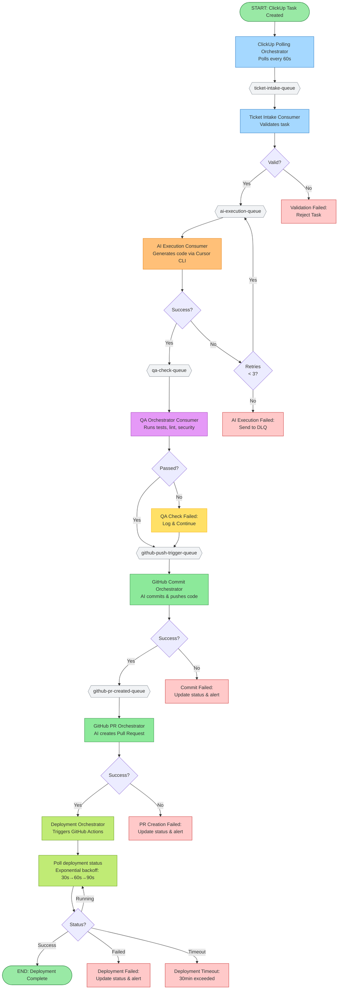

# Dark Software Factory - Task Processing Flow

Complete end-to-end flow showing how tasks move through the system from ClickUp creation to deployment.

## Main Flow Diagram

## Key Components

### 1. **Entry Point: ClickUp Polling**

- Polls ClickUp API every 60 seconds for task updates
- Publishes discovered tasks to `ticket-intake-queue`
- Uses exponential backoff on rate limits

### 2. **Ticket Intake Validation**

- Validates task structure and required fields
- Rejects invalid tasks immediately
- Creates database record for valid tasks
- Publishes to `ai-execution-queue`

### 3. **AI Code Generation**

- Uses Cursor CLI (or other AI providers) to generate code
- Automatically detects project type and installs dependencies
- **Retry Logic**: Up to 3 attempts for transient failures
- Non-retryable errors (invalid prompt, auth failures) sent to DLQ
- Publishes to `qa-check-queue` on success

### 4. **QA Automation**

- Runs automated tests (Jest, pytest, etc.)
- Executes lint checks (ESLint, etc.)
- Performs security scans
- **Failure Handling**: Logs failures but continues workflow
- Publishes to `github-push-trigger-queue`

### 5. **GitHub Commit**

- AI analyzes changes and generates comprehensive commit message
- Follows conventional commits format
- Pushes to feature branch
- Updates database with commit SHA

### 6. **GitHub PR Creation**

- AI generates PR title and description
- Creates PR via GitHub CLI
- Links to original ClickUp ticket
- Publishes to `github-pr-created-queue`

### 7. **Deployment**

- Detects CI/CD provider (GitHub Actions)
- Triggers workflow via Workflow Dispatch API
- **Polling**: Checks status with exponential backoff
- **Timeout**: 30 minutes maximum
- Updates deployment status in database

## Error Handling Summary

| Stage            | Failure Action | Retry?      | Next Step         |
| ---------------- | -------------- | ----------- | ----------------- |
| **Validation**   | Reject task    | ❌ No       | End               |
| **AI Execution** | Send to DLQ    | ✅ Yes (3x) | Continue or fail  |
| **QA Checks**    | Log failure    | ❌ No       | Continue workflow |
| **Commit**       | Update status  | ❌ No       | Alert & end       |
| **PR Creation**  | Update status  | ❌ No       | Alert & end       |
| **Deployment**   | Update status  | ❌ No       | Alert & end       |

## RabbitMQ Queues

1. `ticket-intake-queue` - Raw ClickUp task events
2. `ai-execution-queue` - Validated tasks ready for AI processing
3. `qa-check-queue` - Code generated, ready for QA
4. `github-push-trigger-queue` - QA complete, ready for commit
5. `github-pr-created-queue` - Code committed, ready for PR & deployment

## Monitoring & Metrics

All stages emit Prometheus metrics:

- Success/failure counters
- Duration histograms
- Queue depth gauges
- Error categorization

Critical failures are captured in **Sentry** for alerting and debugging.
